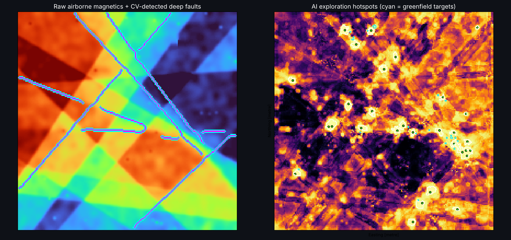

# GeoAI-Prospector

**Multi-modal machine learning and spatial AI for critical-mineral prospectivity mapping in the Northern Territory.**

The pipeline ingests airborne magnetics, gravity, surface geochemistry and known deposits for the East Tennant region (IOCG Cu-Au, buried under cover). It extracts faults with computer vision and scores geochemistry with compositional anomaly detection. It then fuses both modalities in a spatially validated XGBoost model and serves an explainable "exploration hotspot" map in Streamlit.



```
 Geophysical rasters (mag, gravity) ──► Model A: computer vision ─────────────────┐
   any CRS → GDA2020 / MGA53 grid        Canny lineaments, fault distance,        │
                                         intersections, PyTorch CNN autoencoder    ├─► Fusion stack (xarray)
 Geochem points (soil / rock / drill) ─► Model B: compositional anomaly AI ───────┤    + PU labels from known deposits
   BDL handling, units, dedupe           ILR, Isolation Forest + LOF,             │        │
                                         Cu-Au-Bi pivot signatures, IDW            │        ▼
 Known deposits (NTGS / OZMIN) ────────────────────────────────────────────────────┘   Model C: XGBoost, spatial block CV
                                                                                             │
                                                     SHAP per pixel, ranked targets ◄────────┘
                                                     GeoTIFF / GPKG / report / Streamlit app
```

## Results (synthetic benchmark, `make run`)

| Check | Result |
|---|---|
| Spatial block CV ROC-AUC (10 km blocks, 2.5 km exclusion buffer) | **0.935** (0.936 unbuffered; random CV would claim 1.000, which is leakage) |
| PR-AUC (base rate 0.4 %) | 0.415 buffered (0.499 unbuffered) |
| Held-out deposits captured in top 5 % / 10 % of area | **80 % / 93 %** |
| Fusion vs single modality (ROC-AUC) | geophysics 0.79 · structure 0.79 · geochem 0.87 · **fused 0.94** |
| Model A vs planted faults | 98 % precision, 82 % recall (1.5 km tolerance) |
| Uncertainty | per-pixel rank spread across the 5 spatial-CV fold models (percentile points), shipped as a map layer and per-target ± |
| Runtime | ~35 s on a laptop CPU for a 10,000 km² grid at 500 m |

The synthetic generator plants known faults, deposits, cover and sampling bias, so every model can be checked against ground truth. Switch to real data with `make run-real` (see [docs/DATA.md](docs/DATA.md)).

## Quick start

```bash
pip install torch --index-url https://download.pytorch.org/whl/cpu   # CPU build, smaller
pip install -e ".[dev]"
make run        # build everything into outputs/ (synthetic, no downloads)
make app        # http://localhost:8501
make test       # 12 tests incl. a full end-to-end run
```

Or with Docker: `docker build -t geoai-prospector . && docker run -p 8501:8501 geoai-prospector`

## What each stage does, and why

| Stage | Module | Key decisions |
|---|---|---|
| ETL | `etl/raster.py`, `etl/points.py` | Every input is reprojected to one GDA2020 / MGA zone 53 grid (EPSG:7853). Rasters are warped from any CRS (GDA94 or GDA2020 geographic, GeoTIFF or NetCDF). Small gaps are filled and large ones stay NaN. Assays are converted to ppm, below-detection values (`-DL`) are flagged, duplicates are dropped, and points are joined to their exact pixel. |
| Derivatives | `etl/raster.py` | Horizontal gradient, FFT vertical derivative and tilt derivative: the standard toolkit an interpreter would compute by hand. |
| Model A | `features/structure.py` | Canny on gravity (deep, σ = 3 px) and magnetics (shallow, σ = 1.5 px), then skeleton and length filter. Outputs: distance to deep lineament, lineament density, and an orientation-diversity "intersection" index. CV edges are geophysical gradients, not confirmed faults, so independently mapped faults (NTGS/GA geology) enter as a separate feature (`etl/vector.py`). A self-supervised conv autoencoder adds texture features and reconstruction error, with no labels needed. |
| Model B | `features/geochem.py` | Multiplicative replacement for censored values, closure with a residual part, and ILR via a Helmert basis (unit-tested to be an isometry). Isolation Forest and LOF scores are rank-averaged. Pivot z-scores for Cu, Au and Bi separate a Cu-Au anomaly from an unrelated Pb-Zn one. IDW gridding stops at 4 km, so chemistry is never invented. |
| Fusion and labels | `model/fusion.py` | xarray stack of 19 features. Positives lie within 600 m of a deposit and negatives more than 3 km away; the ring in between is excluded. This is a positive-unlabelled problem, so the map is presented as a percentile. |
| Model C | `model/train.py` | XGBoost with `scale_pos_weight`, evaluated with StratifiedGroupKFold over 10 km blocks plus a 2.5 km exclusion buffer around each test block (`cv_buffer_m`), so autocorrelation across block edges cannot leak. Leaky random CV is reported alongside for contrast. Capture efficiency comes from held-out predictions, and the ablation runs per modality. |
| Uncertainty | `model/train.py`, `export.py` | The 5 spatial-CV fold models rank every pixel; the spread of those ranks (in percentile points) is the epistemic-uncertainty layer (`prospectivity_uncertainty.tif`, app layer, ± column on every target). High score + high spread = collect data first. |
| XAI | `model/explain.py` | TreeSHAP for every pixel. Each target polygon gets a plain-English reason, e.g. *"top 0.4 % of area; main reasons: Au enrichment z = 1.5 (+1.95), close to deep gravity fault 0.6 km (+0.9)…"* |
| Delivery | `export.py`, `app/` | Cloud-Optimized GeoTIFFs (GDAL COG driver), GeoPackage, GeoJSON, NetCDF and an auto-generated `REPORT.md`. The Streamlit app has a synced split screen (raw data vs hotspots), click-anywhere SHAP explanations, a target table with downloads, and a model card. |
| Automation | `.github/workflows/` | CI runs lint, tests and a Docker build. A weekly scheduled job checks upstream ETag/Last-Modified, re-runs only when the data changed, and commits the refreshed report and maps, which redeploys the app. |

## Repository layout

```
config/config.yaml          single source of truth: region, grid, CRS, model params, data sources
src/geoai_prospector/
  io/synthetic.py           ground-truth benchmark generator
  io/download.py            public-data download + change detection manifest
  etl/                      raster + point ETL
  features/structure.py     Model A (CV)        features/geochem.py   Model B (CoDA + anomaly)
  model/                    fusion, training, SHAP
  export.py                 GIS + web layers + markdown report
  pipeline.py               CLI orchestrator (geoai --source real --if-changed)
app/streamlit_app.py        interactive map
tests/                      CoDA maths, ETL, structure, end-to-end
```

**Release gate:** [docs/ACCEPTANCE.md](docs/ACCEPTANCE.md) lists the eight acceptance criteria for v1.0; the only open items are the real-data gate.

## Limitations (read before trusting a target)

* **Labels are positive-unlabelled.** Areas without known deposits are unexplored, not barren. Scores are relative ranks, not calibrated probabilities; calibration waits for suitable validation data.
* **A lineament is not a fault.** CV-detected edges are geophysical gradients; mapped faults are a separate, independent feature, and deep-structure claims need geological corroboration.
* **One model per mineral system.** This config targets IOCG Cu-Au. Lithium or cobalt need their own pathfinders, labels and validation — see `config/examples/lithium_lct.yaml`.
* **Sampling bias.** Geochemistry clusters around old prospects. Distance-to-sample is deliberately not a feature.
* **Under cover, surface geochemistry fades.** In the east of the area the model leans on geophysics.
* **Few positives** (tens of deposits) make CV estimates noisy. Report spread across seeds or folds before quoting a number.
* Targets are ranked ideas for a geologist to review. They are not drill recommendations.

## Data and licences
Real-data sources and how to fetch them are listed in [docs/DATA.md](docs/DATA.md). Geoscience Australia and NTGS data are released under Creative Commons; cite the datasets you use.
